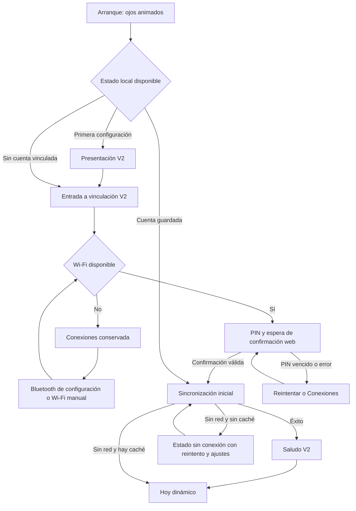
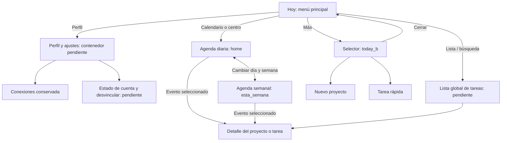

# HAVIT: selección de pantallas y flujo unificado

Fecha de revisión: 14 de octubre de 2026. Estado de implementación actualizado: 15 de octubre de 2026.

Se revisaron los 29 XML, su código C generado, los datos originales de Figma guardados en `.lvgl-flow/screens`, la aplicación portable y la navegación y servicios de `firmware/main/main.cpp`. Se recompiló la biblioteca de UI y se capturaron las 29 vistas con LVGL a 360 × 360. Las capturas muestran diseños y datos de ejemplo; no prueban entradas, servicios remotos ni comportamiento en el dispositivo. Las pantallas de conexiones se analizaron desde su código: no se presentan como capturas nuevas del firmware.

## Implementación parcial aplicada

El firmware ahora muestra `intro_4`, `log_in` y `welcome_back` en lugar de las tres vistas antiguas. El saludo se reserva al primer sync correcto del arranque; una reconexión posterior conserva la ruta actual. Si Hoy está visible, el número de tareas sincronizadas se actualiza en su etiqueta sin reconstruir la pantalla.

La lista conserva su cabecera y controles: filtros, paginación y completar tarea solo actualizan el contenedor de filas. Los dos calendarios conservan las celdas y actualizan mes/día en los widgets existentes. La navegación entre vistas todavía crea la vista destino completa, lo que es apropiado al cambiar de pantalla; los controles que cambian datos dentro de la misma vista no deben reconstruirla.

El botón para generar el plan ya no espera 900 ms en una pantalla de carga ficticia. En ausencia de un endpoint de generación conectado, pasa directamente a la vista local de línea de tiempo, cuyas fechas se distribuyen entre inicio y entrega. Esto no representa una generación remota ni la persistencia del proyecto.

Siguen pendientes la colección de tareas remotas (el sync actual solo extrae perfil y cantidad), editores reutilizables, detalle, persistencia del borrador y el contrato de guardar/generar proyectos. Por tanto, el flujo completo propuesto todavía no está implementado.

## Decisión de integración

La V2 debe aportar la apariencia y el recorrido principal. Las funciones anteriores de configuración y vinculación deben conservarse e integrarse en ese recorrido. La ausencia de una pantalla de configuración en V2 no significa que deba desaparecer. Tampoco una pantalla sin enlace en el XML significa que sea obsoleta.

Los archivos `frame_1`, `frame_2` y `frame_3` pertenecen a Page 1 y son la familia visual anterior. Los otros 26 pertenecen a Wireframe Dark Dev. Esta procedencia y la función de cada pantalla permiten distinguir reemplazos, funciones complementarias y variantes de estado. No hay un historial completo de versiones que permita atribuir una fecha de diseño exacta a cada frame.

| Función | Diseño seleccionado | Tratamiento de la versión anterior |
| --- | --- | --- |
| Presentación inicial | `intro_4`, con identidad HAVIT pendiente de unificar | Sustituye la apariencia de `frame_1` y `create_screen_one`; conservar la condición de primera configuración. |
| Animación de arranque | Ojos de `intro_1/2/3/5` | Reutilizar la animación nativa LVGL existente y adaptar sus medidas; son poses de un mismo componente. |
| Entrada a vinculación | `log_in` | Sustituye la apariencia de `frame_2` y `create_screen_two`; su botón abre el proceso real de vinculación. |
| PIN, espera, error y reintento | `create_pairing_screen` del firmware | Conservar: no hay sustituto completo en V2. Adaptar después al estilo nuevo. |
| Conexiones | `create_wifi_setup_screen` y sus variantes | Conservar Wi-Fi/Bluetooth de configuración, Wi-Fi manual y confirmación de olvidar redes. |
| Saludo de cuenta | `welcome_back` | Sustituye la apariencia de `frame_3` y `create_screen_three`; usar el nombre real. |
| Pantalla principal | `today`, con estado ocupado representado por `today_c` | Sustituye `create_home_placeholder`, que solo muestra un contador. |
| Agenda diaria y semanal | `home` y `esta_semana` | Conservar ambas: son vistas complementarias de agenda, no sustitutos del menú principal. |

## Inventario individual de las 29 pantallas

Las valoraciones se refieren a su papel en el flujo. «Diseño útil» no significa que los controles ya funcionen.

| N.º | Archivo | Función y estado observado | Decisión y conexión propuesta |
| --- | --- | --- | --- |
| 1 | `frame_1` | Bienvenida antigua; diseño anterior. | Referencia archivada. Reemplazar visualmente por `intro_4`, conservar la lógica de primera configuración. |
| 2 | `frame_2` | Inicio de sesión antiguo con Google y textos de ejemplo. | Referencia archivada. Usar `log_in` conectado a vinculación; no simular autenticación por un toque. |
| 3 | `frame_3` | Saludo antiguo con ROM y Continuar. | Referencia archivada. Usar `welcome_back` con nombre real y salida automática; un toque puede omitir el saludo. |
| 4 | `intro_1` | Ojos cerrados; tiempo de Figma no convertido. | Pose del componente de arranque, no destino navegable. |
| 5 | `intro_2` | Ojos abiertos; tiempo de Figma no convertido. | Pose del mismo componente. |
| 6 | `intro_3` | Apertura intermedia; Figma conduce a presentación. | Pose del mismo componente; la salida depende de los datos de arranque. |
| 7 | `intro_5` | Otra pose cerrada con enlace a `intro_2`. | Integrar al parpadeo; no añadir un paso de usuario. |
| 8 | `intro_4` | Presentación V2; dice «Azlo». | Mostrar durante primera configuración. Flecha → `log_in`. Unificar el nombre con HAVIT antes de publicar. |
| 9 | `log_in` | Entrada V2; botón Google y «Con Dispositivo». | Botón → vinculación anterior. El icono sugiere OAuth directo, pero el firmware usa PIN/web: ajustar el mensaje a «Vincular dispositivo». |
| 10 | `welcome_back` | Saludo V2 con «Leo!»; tiempo de 0,8 s no importado. | Nombre de cuenta y salida a Hoy tras sincronización inicial. No repetir en cada reconexión. |
| 11 | `today` | Menú radial, 0 tareas, perfil/lista/calendario/+. | Principal canónica. Fecha y contador dinámicos. Dar acción a los cuatro accesos y al centro. |
| 12 | `today_c` | Figma representa 1 tarea, pero el XML actual muestra 0. | Variante ocupada de Hoy; compartir plantilla y estado con `today`, no cambiar de archivo para aumentar el contador. |
| 13 | `today_b` | Selector Agregar tarea/Tarea rápida; fecha distinta. | Overlay del botón +. X → pantalla que lo abrió; heredar fecha y contador. |
| 14 | `home` | Agenda diaria orbital con materias y hora. | Vista de agenda del día; calendario de Hoy o toque del centro → esta vista. Arrastre horizontal → semana, con alternativa visible. |
| 15 | `esta_semana` | Agenda semanal orbital sin salida declarada. | Vista complementaria; rango de siete días y eventos reales. Volver a día y a Hoy; tocar evento abre el proyecto seleccionado. |
| 16 | `add_task_p1` | Nombre y materia, X y siguiente. | Paso 1 del borrador de proyecto. Validar nombre; seleccionar/editar materia. X solicita descartar solo si hay cambios. |
| 17 | `add_task_p2` | Fecha final y descripción. | Paso 2. Fecha con selector; descripción editable. Anterior conserva el borrador. |
| 18 | `add_task_p3` | Inicio y entrega final con hora. | Paso 3. Heredar la entrega del paso 2, permitir ajustarla y exigir final posterior al inicio. No pedir dos fechas finales independientes. |
| 19 | `add_task_p4` | Botón Generar fechas. | Resumen y confirmación de generación. Un envío por solicitud; anterior → paso 3. |
| 20 | `add_task_p5_d` | Carga; avanza al tocar toda la pantalla. | Estado de solicitud pendiente. Éxito real → resumen; error → reintentar/volver sin perder datos. Un toque no equivale a éxito. |
| 21 | `add_task_p5_e` | Portada del proyecto y línea de tiempo. | Resumen del resultado generado. Siguiente → calendario del intervalo del proyecto. Título/materia del borrador. |
| 22 | `add_task_p5` | Calendario de octubre de ejemplo. | Primera representación del componente calendario de proyecto. Selección por fecha; siguiente mes actualiza datos. |
| 23 | `add_task_p5_b` | Calendario de noviembre; contiene 31 en la maqueta. | Mismo componente, otro mes. Calcular días válidos y primer día de semana. No limitar a octubre–diciembre de 2026. |
| 24 | `add_task_p5_c` | Calendario de diciembre y fechas resaltadas. | Mismo componente. Meses anterior/siguiente y fechas de hitos reales. Último mes depende del proyecto. |
| 25 | `desglose_b` | Lista de entregables, fechas, lápiz y flechas. | Revisión editable del plan generado. Flecha de fila abre/edita ese hito; check acepta el borrador y pasa a notificaciones. No es la lista global de tareas. |
| 26 | `desglose` | Notificaciones: Sonido/Luz-Color/Tono y Agregar tarea. | Configurar avisos del proyecto. Campos reales. Check → guardar; éxito → Hoy actualizado. Error mantiene el borrador y permite reintentar. |
| 27 | `add_task_p1_b` | Formulario de tarea rápida y duración. | Rama independiente. Validar nombre y duración mayor que cero. Empezar → sesión activa. X → origen. |
| 28 | `add_task_p1_c` | Temporizador de ejemplo 00:20:00, check y X. | Mostrar tiempo restante real. Check → completar con registro; X → cancelar con confirmación si procede. Salir de vista no debe completar ni reiniciar la sesión. |
| 29 | `add_task_p1_d` | Confirmación Completado con Humanidades. | Nombre de la tarea real; check → origen/Hoy actualizado. Llegar solo tras completar, nunca simplemente por navegar. |

## Funciones anteriores que deben permanecer

| Vista del firmware | Entrada | Salida y regla |
| --- | --- | --- |
| Vincula tu HAVIT | Botón de `log_in`, cuenta sin vínculo o solicitud explícita de volver a vincular. | PIN listo → esperar confirmación web; confirmación válida y sincronización → saludo/Hoy. Volver → entrada de vinculación. |
| Conexiones | Vinculación y Perfil/Ajustes desde Hoy. | Volver restaura exactamente la vista de origen. Abrir ajustes desde un formulario no debe destruir su borrador. |
| Wi-Fi manual | Conexiones → Wi-Fi manual. | Muestra red temporal y acceso local de configuración. Volver → Conexiones. Distinguir red de configuración de red doméstica conectada. |
| Confirmar olvidar redes | Conexiones → Olvidar redes Wi-Fi. | Cancelar → Conexiones. Confirmar borra redes y vuelve a configuración de red; conserva la cuenta, como indica el texto actual. |
| Avisos de conexión/PIN | Espera, fallo de servidor, PIN vencido. | Mostrar estado y reintento en el contexto actual, sin obligar a repetir la presentación. |

La pantalla provisional «HAVIT OS / Inicio preparado / Tareas sincronizadas» se reemplaza por Hoy. Sus datos sincronizados deben alimentar las vistas nuevas.

## Flujo de arranque recomendado

El parpadeo puede repetirse mientras se lee el estado y se inicia la carga. Si una operación tarda o falla, debe aparecer un estado comprensible con salida y reintento; no un bucle de ojos indefinido. La continuación con caché es comportamiento propuesto: todavía falta almacenar y recuperar esas tareas.

Con una cuenta guardada, un fallo de red no debe tratarse como cierre de sesión. Solo una invalidación de credenciales debe llevar a revincular. La conexión Wi-Fi, la vinculación de cuenta y la sincronización son estados distintos.

## Navegación principal recomendada

La elección de calendario/centro → agenda diaria y perfil → ajustes es una propuesta de conexión basada en los iconos. Figma exportado no define esos destinos. No hay que confundir la agenda orbital diaria con el menú radial de Hoy: pueden convivir y ambas pertenecen a la familia nueva.

La lista global, el contenedor de perfil/ajustes, el selector de fecha/hora, los editores y el detalle de hito requieren vistas o componentes funcionales. No tienen un diseño completo equivalente entre los 29 XML. La plantilla de desglose puede servir de base visual para una lista, pero su modelo de datos debe distinguir tareas globales e hitos de un proyecto.

## Creación de un proyecto

1. **Hoy → + → Agregar tarea.** Crear un borrador nuevo. Estado: entrada clara; falta acción central unificada.
2. **Nombre y materia (`add_task_p1`).** Estado: diseño útil; entradas decorativas actualmente. Validar nombre y ofrecer selección de materia.
3. **Fecha final y descripción (`add_task_p2`).** Estado: diseño útil; faltan selectores y editor. Conservar lo ya escrito al retroceder.
4. **Inicio y fin con hora (`add_task_p3`).** Estado: necesita unificar la fecha final con el paso anterior y validar el intervalo.
5. **Confirmar generación (`add_task_p4`).** Estado: falta conectar el botón al servicio y bloquear dobles envíos.
6. **Generando (`add_task_p5_d`).** Estado: salto incorrecto por clic. Esperar resultado, con error, cancelación y reintento definidos.
7. **Resumen (`add_task_p5_e`).** Estado: útil como introducción al resultado, con contenido dinámico.
8. **Calendario (`add_task_p5/p5_b/p5_c`).** Estado: maquetas de meses; convertir en calendario único alimentado por hitos. Anterior vuelve al resumen y no al formulario vacío.
9. **Desglose (`desglose_b`).** Estado: revisión sin edición funcional. Permitir corregir fechas y entregables antes de guardar.
10. **Notificaciones (`desglose`).** Estado: selectores aparentes sin opciones ni cambios de valor conectados.
11. **Guardar y volver a Hoy.** Estado: falta persistencia del proyecto y confirmación de éxito. El contador cambia según los datos guardados y el día seleccionado, no según el archivo que se abre.

El resultado de generación es un plan propuesto. Navegar por sus meses no debe crear varias tareas. «Agregar tarea» es la confirmación final que guarda el proyecto y sus hitos. Volver permite revisar sin guardar duplicados. Si el servidor ya crea borradores durante la generación, debe devolver un identificador y un estado de borrador para confirmarlo una sola vez.

## Tarea rápida

1. **Hoy → + → Tarea rápida (`add_task_p1_b`).** Nombre y duración. Estado: falta edición real y validación.
2. **Empezar → sesión activa (`add_task_p1_c`).** Guardar identidad y momento de finalización. Estado: hoy el número es texto fijo.
3. **Check → completar → confirmación (`add_task_p1_d`).** Registrar la finalización y refrescar las vistas afectadas. Estado: actualmente solo navega.
4. **X → cancelar.** No marcar como completado. Si se abandona solo la vista, conservar el temporizador activo y ofrecer cómo volver a él. Estado: decisión pendiente en el comportamiento actual.
5. **Volver a Hoy/origen.** Mostrar el estado real de la sesión y de las tareas del día.

Propuesta al agotarse el tiempo: indicar «Tiempo terminado» y pedir confirmar la tarea; el transcurso del tiempo por sí solo no demuestra que se completó. El temporizador se calcula con una referencia monotónica, independientemente del refresco de pantalla o de la conexión.

## Cómo conectar UI, estado y servicios

### Una sola navegación

Ampliar la aplicación de los cuatro estados actuales a rutas con parámetros. La UI emite intenciones (`abrir_agenda`, `editar_nombre`, `generar_plan`, `confirmar_proyecto`), la aplicación valida y actualiza el estado, y el renderizador muestra la vista correspondiente. Evitar que cada XML cree libremente la pantalla siguiente sin pasar por la aplicación.

Mantener una pila de retorno para overlays y editores. Separar `ruta_actual`, `ruta_de_origen`, `fecha_seleccionada`, `proyecto_seleccionado`, `borrador` y `sesion_rapida`. Una reconexión de red no debe volver a abrir la bienvenida ni borrar un formulario. El código actual solicita sincronización al reconectar y, al recibir cuenta lista, cambia a bienvenida; esa salida debe reservarse al arranque o a una vinculación explícita.

### Datos compartidos

| Modelo | Campos mínimos y uso |
| --- | --- |
| Cuenta | Identificador, nombre, estado de vinculación; el token queda en el adaptador seguro del dispositivo. |
| Conexiones | Wi-Fi conectado, red, configuración BLE/AP activa, operación pendiente y error; no implican sesión autenticada. |
| Tareas/proyectos | Identificador, título, materia, estado, fechas y zona horaria, hitos, preferencias de notificación y versión de sincronización. |
| Borrador | Nombre, materia, descripción, inicio, final, plan propuesto y cambios; vive durante todo el asistente. |
| Calendario | Fecha seleccionada, mes visible e hitos filtrados; fechas válidas calculadas, sin textos de ejemplo fijos. |
| Tarea rápida | Identificador, nombre, duración, instante límite y estado activo/cancelado/completado. |
| Sincronización | Último éxito, pendientes locales, identificador de operación y error recuperable. |

Hoy, agenda diaria, semana y lista deben leer la misma colección. El significado del contador de Hoy propuesto es «tareas pendientes con vencimiento o programación en el día seleccionado», contando cada tarea una sola vez. Los hitos se distinguen de sus proyectos para no duplicar totales. Esa regla debe acordarse con el modelo real del servicio.

### Qué existe y qué falta en el servicio

En este firmware están integradas las llamadas `startWatchPairing`, `pollWatchPairing` y `syncWatch`. `sync_watch_account()` extrae el nombre y el número de tareas; no construye una colección de tareas para las vistas. La respuesta HTTP usa un límite de 3072 bytes, que debe revisarse junto con paginación/tamaño antes de sincronizar colecciones mayores.

No se encontró en esta integración del firmware una llamada para generar planes, guardar proyectos, editar hitos o completar tareas. Esto no prueba que el servidor carezca de ellas; requiere revisar su contrato. No asignar nombres de endpoints nuevos como si ya existieran.

Operaciones que la UI necesita del adaptador: cargar lista y detalle, generar plan, confirmar/guardar borrador, actualizar hitos, configurar avisos y registrar finalización. Cada una debe devolver éxito, datos, error e identificador para evitar duplicados por reintento. Las peticiones corren fuera del hilo de LVGL y publican resultados al hilo de UI.

### Entradas y avisos

Los lápices, micrófonos, calendarios y desplegables son imágenes/objetos visuales en las pantallas inspeccionadas. No encontré `lv_textarea`, `lv_keyboard`, `lv_calendar`, `lv_dropdown` ni callbacks de cambio de valor en estos C generados. Hay que vincularlos a editores y modelos antes de considerar operativo el flujo.

La entrada por voz necesita comprobar captura de audio y servicio de transcripción; no está conectada en estas pantallas. Mantener una alternativa de escritura/edición desde la aplicación acompañante. Sonido, luz y tono deben corresponder a capacidades reales de la placa y sus controladores; no mostrar una preferencia como operativa solo porque tenga un icono.

## Problemas confirmados y prioridad

| Prioridad | Hallazgo | Corrección necesaria |
| --- | --- | --- |
| P0 | El simulador inicia `intro_1`, que no tiene salida importada. | Arranque controlado por la aplicación y animación por estados, con condiciones de salida. |
| P0 | Tiempos de intro y saludo y gestos no se convirtieron. | Restaurar su intención en la navegación real; ver los datos de Figma conservados. |
| P0 | El XML salta de `log_in` a saludo por clic. | Abrir PIN/configuración y esperar autenticación válida. |
| P0 | El firmware termina en inicio provisional. | Usar Hoy nuevo sin perder vinculación y conexiones anteriores. |
| P0 | Campos, guardado y temporizador carecen de integración funcional. | Modelos, validaciones, operaciones asíncronas y persistencia. |
| P1 | Carga se omite tocando la pantalla. | Responder al resultado real de generación. |
| P1 | Reconectar puede enviar a bienvenida desde otra tarea. | Sincronizar conservando la ruta, borrador y sesión activa. |
| P1 | Configuración vuelve mediante banderas específicas y no un origen general. | Pila de retorno válida desde cualquier pantalla nueva. |
| P1 | Fechas, nombres y contadores son datos de ejemplo inconsistentes. | Una fuente de estado, zona horaria y regla de conteo. |
| P1 | Noviembre contiene 31 y los meses son pantallas fijas. | Un calendario calculado y límites según el proyecto. |
| P2 | `intro_4` dice Azlo, versiones previas dicen Havit; nombres ROM/Leo de ejemplo. | Unificar identidad del producto y usar el nombre real de cuenta. |
| P2 | En los renders algunas introducciones, notificaciones y vistas de tarea rápida pierden partes laterales del aro; algunos textos son muy pequeños. | Revisar recortes y legibilidad después de estabilizar plantillas; no afirmar que todo el diseño ya es correcto. |

El análisis anterior que calificaba Home o Semana como aisladas era incompleto: los datos originales sí contienen Home → Semana mediante `ON_DRAG`, y saludo → Hoy mediante un timeout de 0,8 s. La exportación a XML perdió esas acciones. También aparecen Intro 1 → Intro 2 (0,1 s), Intro 2 → Intro 3 (0,05 s), Intro 3 → Intro 4 (1 s) e Intro 5 → Intro 2 (0,1 s). No forman por sí solas un bucle completo condicionado a carga.

## Orden de implementación

1. Crear el catálogo único de rutas y conservar los servicios anteriores de red y PIN.
2. Conectar arranque, presentación, vinculación, saludo y Hoy usando las vistas V2.
3. Mantener Perfil/Ajustes → Conexiones, Wi-Fi manual y confirmación de olvidar redes con retorno correcto.
4. Convertir Hoy/agenda/semana en vistas de la colección sincronizada; integrar lista y detalle pendientes.
5. Implementar borrador compartido, editores y calendario dinámico del asistente de tareas.
6. Integrar generación/guardado con el contrato real del servicio y sus estados de fallo.
7. Implementar tarea rápida y sus estados de tiempo, cancelación y finalización.
8. Ajustar animaciones y comprobar cada ruta en simulador; medir memoria, rendimiento, sonido, luz, red y tacto en el dispositivo cuando esté disponible.

## Evidencia y límites

La galería `index.html` contiene las 29 capturas LVGL, una decisión por pantalla y las reacciones Figma conservadas. `inventory.json` conserva el inventario, rutas XML y originales. `proposed-flow.json` conserva el flujo objetivo y enumera explícitamente los tramos implementados y pendientes. Las tres hojas de imágenes permiten comparar todas las vistas sin abrir los XML.

Las capturas no verifican foco, lectores de pantalla, áreas táctiles reales, persistencia, Wi-Fi/Bluetooth, acceso al servicio, audio, luz ni velocidad en ESP32. Los renders también muestran tamaños de texto de 5–8 px en algunas vistas de agenda/calendario y botones pequeños: ampliar el área táctil sin cambiar necesariamente el icono y ofrecer lista legible como alternativa. No se evaluó cumplimiento completo de accesibilidad.

No se cambiaron las rutas de producción ni se grabó el dispositivo en esta revisión. La implementación deberá seguir esta propuesta y resolver los contratos pendientes; no basta con encadenar los archivos XML.
